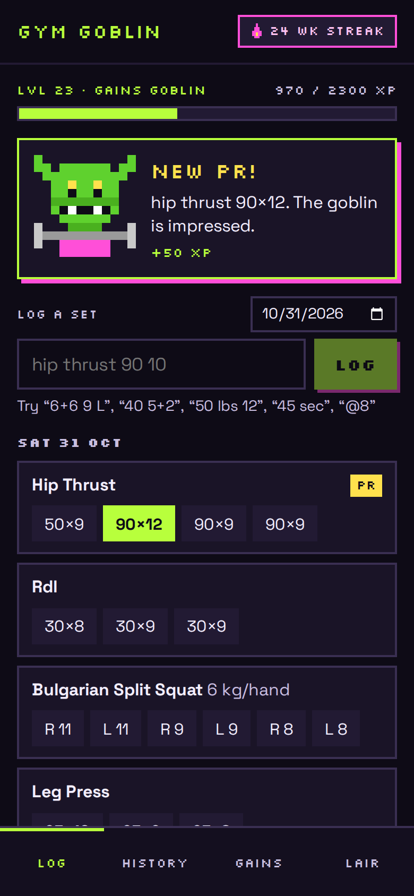
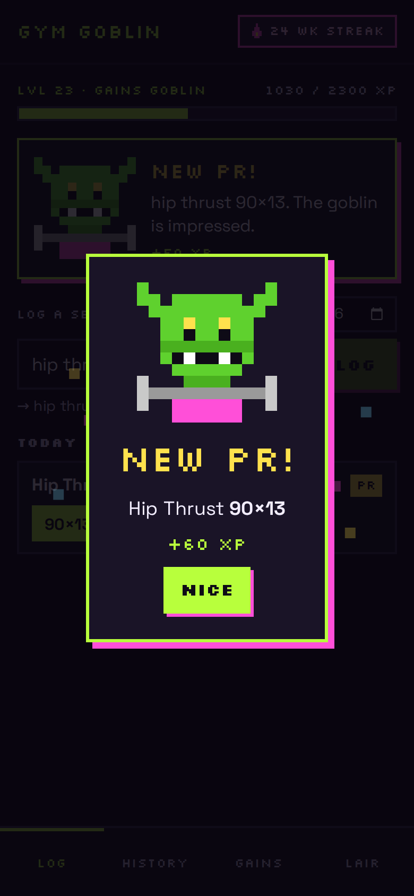
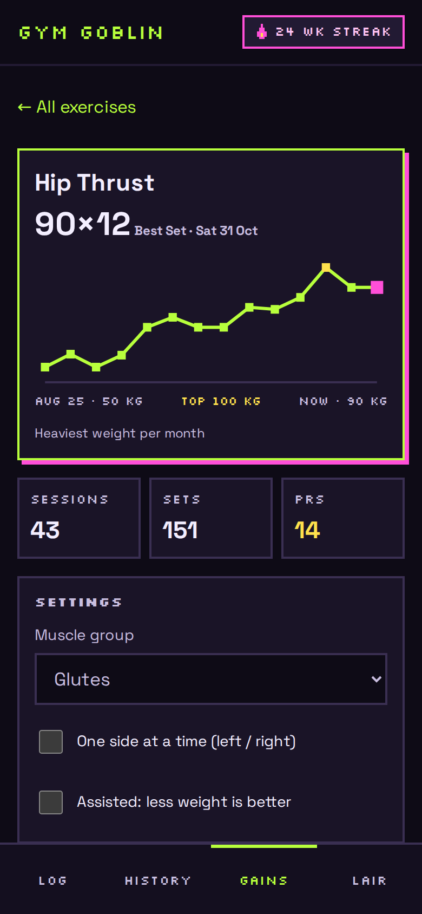
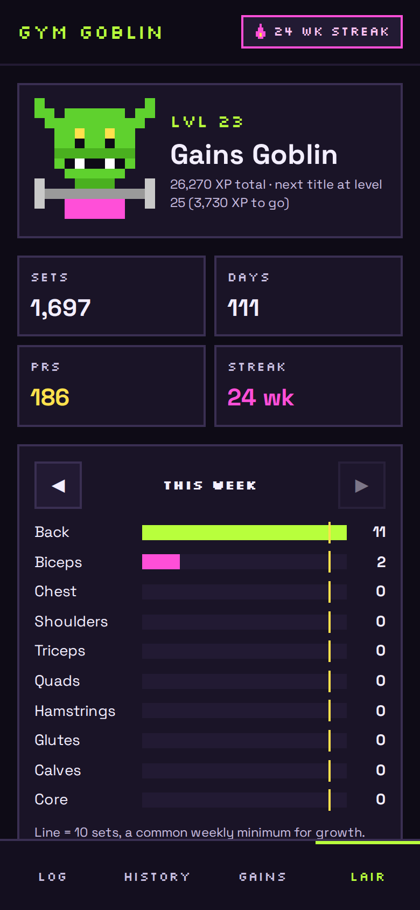

# Gym Goblin

[](https://github.com/kerokeroe/gym-goblin/actions/workflows/ci.yml)

A pixel-art gym tracker. Log a set in one line, beat your records, level up your goblin.

<p>
  
  
  
  
</p>

## Why

I logged my workouts as quick notes in Telegram between sets ("hip thrust 90 11", then just "9" for the next set) and retyped them at home. Gym Goblin keeps that speed: you type the same short line, it understands it, and it turns a year of numbers into records, streaks and charts.

## Features

- **One-line logging** with a live preview of what was understood:

  | You type | It saves |
  |---|---|
  | `hip thrust 90 11` | 90 kg × 11 |
  | `bulgarian 6+6 9 L` | 6 kg per hand × 9, left side |
  | `assisted pull up 40 5+2` | 40 kg assistance × 5, +2 extra reps |
  | `cable row 50 lbs 12` | 22.68 kg × 12 |
  | `plank 1:30` | 90 seconds |
  | `rdl 30 8 @8` | 30 kg × 8 at RPE 8 |

  Exercise names match by prefix (`bulg` → bulgarian split squat), and after a set the name stays in the box, so the next set is just numbers.
- **Personal records** detected automatically, with a full-screen celebration. Assisted exercises count less assistance as better; timed holds compare seconds.
- **XP, levels and weekly streaks**: 10 XP per set, 50 per record.
- **Progress per exercise**: monthly chart, best set, totals.
- **Weekly sets per muscle group** against a 10-set target.
- **History** with a 16-week activity grid; tap any set to edit or delete it.
- **Telegram bot** for logging from the phone (see below).
- **History import**: 1,300+ sets imported from a year of free-text Telegram notes, with dry run, backup and de-duplication.

## Tech

React 18 + TypeScript + Vite · Express · SQLite · node:test · GitHub Actions

How the pieces fit together, and why: [docs/ARCHITECTURE.md](docs/ARCHITECTURE.md).

## Run locally

Requires Node.js 24.

```bash
git clone https://github.com/kerokeroe/gym-goblin.git
cd gym-goblin
npm install
cp .env.example .env   # only needed for the Telegram bot
npm run dev            # API on :4000, web app on http://localhost:5173, bot
```

To run without the bot: `npm run server` and `npm run client` in two terminals. The database is created at `data/gym.db` on first start (override with `GYM_DB=/path/to.db`).

## Tests

```bash
npm test            # quick-log parser, records/XP/streaks, migrations, import, API
npm run typecheck   # TypeScript
npm run build       # production build
```

CI runs all three on every push and pull request.

## Logging from Telegram

1. Create a bot with [@BotFather](https://t.me/botfather) (`/newbot`) and put the token in `.env` as `TELEGRAM_BOT_TOKEN`.
2. Run `npm run bot` (or `npm run dev`), message the bot, and add the chat id it replies with to `.env` as `TELEGRAM_ALLOWED_CHAT_ID`. Only that chat is accepted from then on.
3. `/log` walks you through a set with buttons. `/quick <exercise>; <reps>; <weight>; <rpe>` logs one or more sets in a single message, and works even if the bot was offline when you sent it.

The bot uses long polling, so nothing is exposed to the internet, but it only saves while the server and bot are running.

## Scripts

| Command | What it does |
|---|---|
| `npm run import:telegram -- <dir> <filtered.json> [--apply]` | Import reviewed sets from a Telegram export (dry run unless `--apply`) |
| `node scripts/filter-telegram.js <result.json>` | Shrink a Telegram export to gym-like messages (`date` + `text` only) |
| `npm run migrate-lbs-to-kg` | One-off: convert old pound weights to kg (makes a backup first) |

## License

[MIT](LICENSE)
